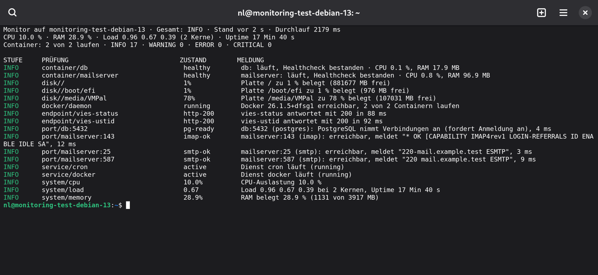
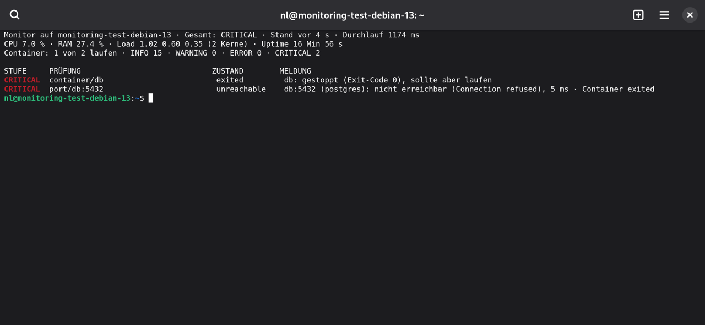
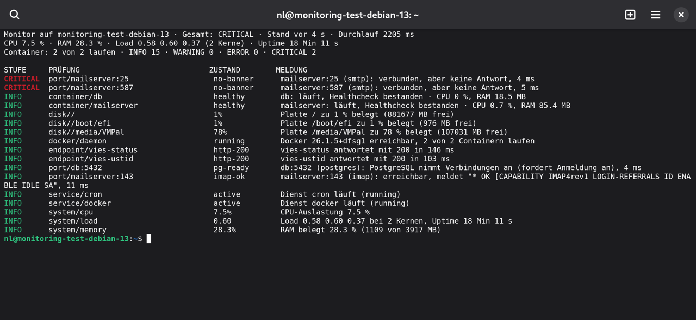
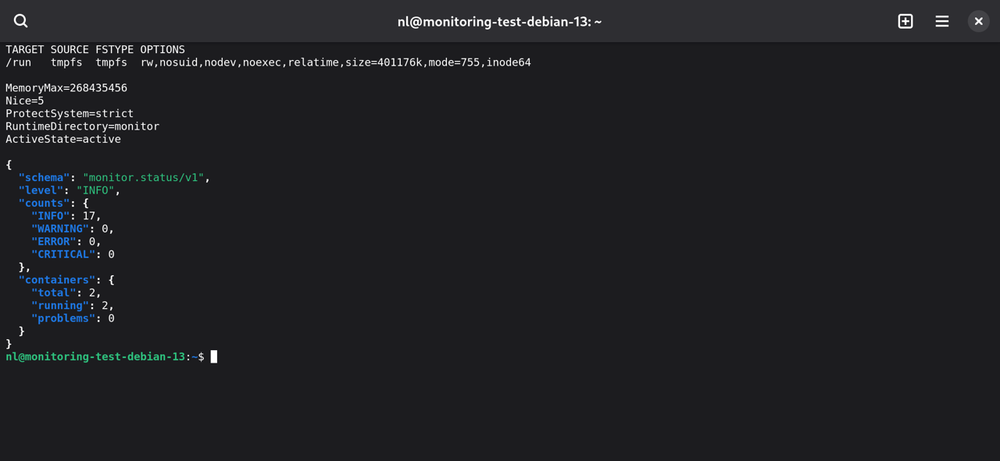
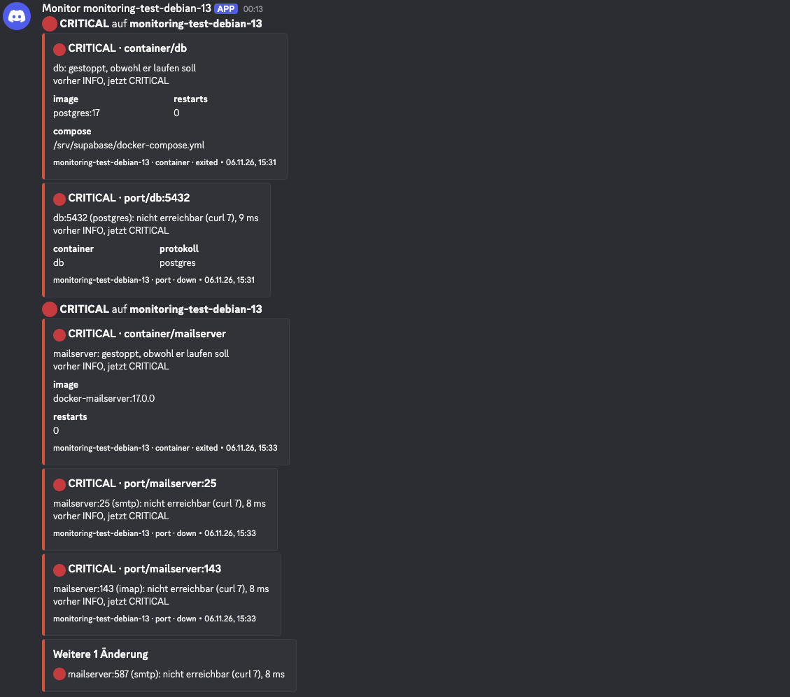
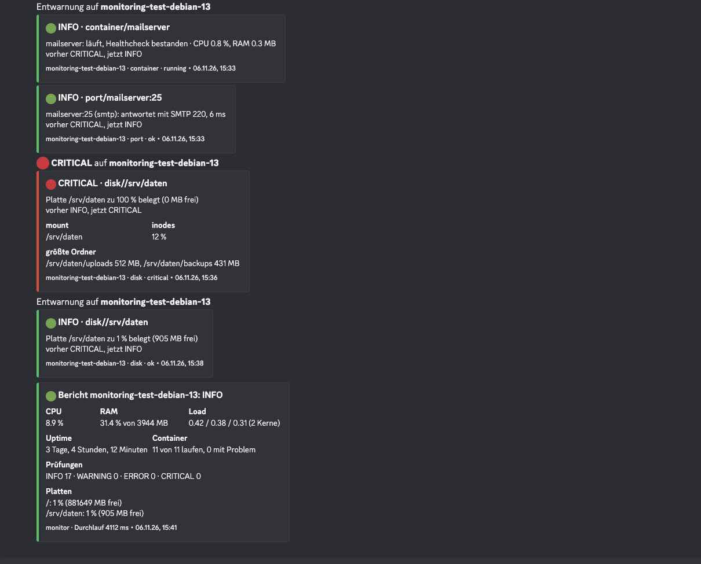

# Monitoring für Datenbank- und Mailserver

Ich habe das Monitoring für [#14](https://github.com/Finn2103/maschinen-verwaltung/issues/14)
nach [ADR 0012](../adr/0012-monitoring.md) umgesetzt und auf einer Debian-13-VM in VMPal auf
meinem MacBook durchgetestet. Alle genutzten Prompts im Wortlaut und meine Bewertungen dazu
stehen in [`docs/ki/prompts/Nico-Laeser.md`](../ki/prompts/Nico-Laeser.md).

Mir war wichtig, dass das Ganze im Betrieb so einfach wie möglich bleibt: eine einzige
Skriptdatei, eine aufgeräumte Konfigurationsdatei ohne Passwörter und keine zusätzliche
Container-Schicht, die ausgerechnet dann mit ausfällt, wenn Docker oder die Platte Probleme
macht.

## Auf einen Blick

| | |
| --- | --- |
| **Abgabe** | [`infra/monitoring`](../../infra/monitoring): `monitor` (Bash-Skript, 11 Abschnitte), `monitor.conf` (standardisierte Konfiguration, 6 Abschnitte), [`INSTALL.md`](../../infra/monitoring/INSTALL.md), [`SKILL.md`](../../infra/monitoring/SKILL.md) |
| **Zugangsdaten** | keine – Datenbank und Mailserver werden ohne Anmeldung über ihre Ports geprüft. Einziges Geheimnis ist die Webhook-Adresse, und die liegt nur auf dem Server |
| **Installation** | `sudo infra/monitoring/monitor install --config infra/monitoring/monitor.conf` |
| **Übersicht** | `monitor status` per SSH (funktioniert auch ohne `sudo`), `monitor status --json` für andere Programme |
| **Tests** | [`tests/`](tests/README.md): 22 Tests am 06.11.2026 mit Befehlen, Original-Ausgaben und Server-Logs (**128 von 128 Prüfungen bestanden**, dazu Neustart von Hand) |
| **Befunde** | [`befunde.md`](befunde.md): Fehler, die mir erst in den Testläufen aufgefallen sind, mit Log-Auszügen |
| **Testskript** | [`tests/vm-test.sh`](tests/vm-test.sh) – nur für die Test-VM, nicht für den Produktivserver |

## Akzeptanzkriterien

| Kriterium aus #14 | Nachweis | Stand |
| --- | --- | --- |
| Nutzwertanalyse erstellt | [ADR 0012](../adr/0012-monitoring.md), PR [#76](https://github.com/Finn2103/maschinen-verwaltung/pull/76) | erfüllt (09.10.) |
| Umsetzung geplant | ADR 0012, Abschnitt „Wie das Skript aussehen würde“ | erfüllt (09.10.) |
| Verfügbarkeit, Ressourcenauslastung und Fehlerzustände beider Dienste in einer Übersicht | [02 Übersicht](tests/02-uebersicht.md), [03 Container-Zustände](tests/03-container-zustaende.md) | erfüllt |
| Benachrichtigung bei nicht erreichbarem Dienst und bei vollem Speicher | [05 Datenbank](tests/05-datenbank-aus.md), [06 Mailserver](tests/06-mailserver-aus.md), [11 Postfix](tests/11-postfix-aus.md), [07 Dienst](tests/07-systemd-dienst-aus.md), [08 Schnittstelle](tests/08-api-falsch.md), [12 Docker](tests/12-docker-aus.md), [09 Platte](tests/09-platte-voll.md), [10 RAM](tests/10-ram-voll.md) | erfüllt |
| Beide Fälle künstlich herbeigeführt, Benachrichtigung angekommen | in jeder Testdatei: Befehl, Server-Log und angekommene Meldung im Original (Discord-Format und JSON) | erfüllt in der Test-VM (lokaler Empfänger), zusätzlich im Team-Kanal angekommen |
| Monitoring-Konfiguration als Code im Repository | [`infra/monitoring`](../../infra/monitoring), [01 Installation](tests/01-installation.md) | erfüllt mit dem Merge nach `staging` |

## Definition of Done

| Punkt | Stand |
| --- | --- |
| 1. Akzeptanzkriterien erfüllt und abgehakt | in der Test-VM belegt; Haken im Issue setze ich erst nach Merge/Abnahme |
| 2. Branch nach Konvention, PR, Review | Branch `infra/14-monitoring`, PR nach `staging`, Review offen |
| 3. Läuft auf der Strato-Umgebung | **offen.** Geht erst, wenn Datenbank ([#11](https://github.com/Finn2103/maschinen-verwaltung/issues/11)), Mailserver ([#13](https://github.com/Finn2103/maschinen-verwaltung/issues/13)) und Playbook ([#5](https://github.com/Finn2103/maschinen-verwaltung/issues/5)) dort laufen |
| 4. Schemaänderungen als SQL-DDL | betrifft nicht |
| 5. Infrastruktur als Code | `monitor install --config …` aus dem Repo, beliebig oft wiederholbar ([01](tests/01-installation.md)) |
| 6. Keine Secrets | keine DB- oder Mail-Passwörter nötig ([04](tests/04-ohne-passwoerter.md)); Webhook-URL nur auf dem Server |
| 7. Dokumentation nachgezogen | dieses Dokument, [ADR 0012](../adr/0012-monitoring.md), [README](../../README.md), Prompts in [`Nico-Laeser.md`](../ki/prompts/Nico-Laeser.md) |
| 8. UI | betrifft nicht |
| 9. Board auf Done | nach Abnahme (solange DoD 3 offen ist, bleibt das Issue auf `Testing` / offen) |

## Aufbau

- **Eine Datei in Bash (`infra/monitoring/monitor`).** Braucht auf Debian 13 nur `bash`, `curl`, `jq` und Standard-Tools, `shellcheck` läuft ohne Warnungen durch. Der Code ist in 11 nummerierte Blöcke gegliedert und mit kurzen deutschen Kommentaren über jeder Funktion versehen, damit man sich schnell zurechtfindet.
- **Direkt auf dem Server statt im Container.** `monitor install` richtet `monitor.service` ein: automatischer Neustart bei Absturz, Dateisystem schreibgeschützt (`ProtectSystem=strict`), `Nice=5`, Speicherlimit 256 MB.
- **Nur im RAM.** Laufzeitdaten liegen ausschließlich unter `/run/monitor` (`tmpfs`). Selbst wenn die Platte bei 100 % steht, prüft und meldet das Skript weiter.
- **Alle 10 Sekunden parallel.** Alle vier Module laufen gleichzeitig; die Ergebnisse landen atomar in `/run/monitor/status.json`, der Spam-Schutz filtert im RAM und Webhooks gehen im Hintergrund mit Retries raus.
- **Keine Zugangsdaten.** Veröffentlichte Container-Ports liest `monitor` direkt aus der Docker-API. PostgreSQL prüft es über den Startup-Handshake wie `pg_isready` (der Server fordert eine Anmeldung an – angemeldet wird nie), SMTP und IMAP über ihre Begrüßung, Webports über HTTP.

| Modul | Was es prüft |
| --- | --- |
| `system` | CPU, RAM (inkl. der 3 größten Prozesse), Load 1/5/15, Uptime, Platten und Inodes (ab ERROR mit den größten Ordnern) |
| `docker` | alle Container über den Docker-Socket (Zustand, Healthcheck, Neustarts, CPU, RAM, Pfade) plus alle veröffentlichten Ports – auch bei gestopptem Container oder ausgefallenem Docker |
| `services` | konfigurierte systemd-Dienste |
| `endpoints` | zusätzliche Schnittstellen: `http` (z. B. VIES aus #7), `postgres`, `smtp`, `imap`, `tcp` |

| Stufe | Typische Auslöser |
| --- | --- |
| INFO | läuft, `healthy`, Port antwortet, einmaliger Job mit Exit-Code 0 |
| WARNING | Healthcheck startet, pausiert, angelegt, PostgreSQL startet, RAM ab 85 %, Platte ab 80 % |
| ERROR | `unhealthy`, Neustart-Schleife, gestoppt obwohl er laufen soll, RAM ab 95 %, Platte ab 90 % |
| CRITICAL | Datenbank oder Mailserver aus, ihr Port nicht erreichbar, Docker aus, OOM-Killer, RAM ab 98 %, Platte ab 95 % |

**Spam-Schutz:** Eine neue Stufe muss erst zwei Durchläufe stabil anliegen, und pro Prüfung gehen höchstens zwei Meldungen in zehn Minuten raus. Verschlechterungen und die Entwarnung nach einem gemeldeten Problem gehen immer sofort durch.

**Schnittstelle für andere Programme:** `status.json` (`monitor.status/v1`), Webhook-Events (`monitor.event/v1`), Berichte (`monitor.report/v1`) und der Exit-Code von `monitor status` (0 bis 3 je nach höchster Stufe, 4 wenn der Dienst nicht läuft).

## Tests

Alle 22 Tests liefen am 06.11.2026 auf einer Debian-13-VM in VMPal auf meinem MacBook ([Übersicht](tests/README.md)). Jede Datei enthält die Anforderung, die ausgeführten Befehle, das Server-Log und die angekommenen Meldungen im Original.

| Test | künstlich herbeigeführt | Ergebnis |
| --- | --- | --- |
| [01 Installation](tests/01-installation.md) | `monitor install --config` zweimal, `webhook-add` und `-remove` auf mehrzeiliger Config | idempotent, eine Datei, Config `root 0600`, Dienst aktiv |
| [02 Übersicht](tests/02-uebersicht.md) | – | DB und Mailserver als Container + Ports, dazu System, Platten, Dienste, VIES |
| [03 Container-Zustände](tests/03-container-zustaende.md) | 11 echte Container, 13 nachgestellte Zustände | jeder Zustand richtig eingestuft, auch `dead`, `removing`, OOM |
| [04 Ohne Passwörter](tests/04-ohne-passwoerter.md) | Config ohne Zugangsdaten und ohne Ports | Ports selbst erkannt, PostgreSQL ohne Login geprüft, keine Login-Fehler im DB-Log |
| [05 Datenbank aus](tests/05-datenbank-aus.md) | `docker stop db` | CRITICAL für Container und Port 5432 nach 14 s, Entwarnung nach 16 s |
| [06 Mailserver aus](tests/06-mailserver-aus.md) | `docker stop mailserver` | CRITICAL für Container und Ports 25/143/587 nach 9 s, Entwarnung nach 34 s, nicht unterdrückt |
| [07 Dienst aus](tests/07-systemd-dienst-aus.md) | `systemctl stop demo-dienst` | ERROR nach 10 s, Entwarnung |
| [08 Schnittstelle falsch](tests/08-api-falsch.md) | Test-API liefert 503 | ERROR mit Statuscode und Antworttext, Entwarnung |
| [09 Platte voll](tests/09-platte-voll.md) | `/srv/daten` bis 0 MB frei | CRITICAL nach 11 s mit den größten Ordnern, Monitoring läuft weiter |
| [10 RAM voll](tests/10-ram-voll.md) | `python3` belegt RAM bis ca. 97 % (Swap aus) | ERROR nach 14 s mit `python3` als Verursacher |
| [11 Postfix aus](tests/11-postfix-aus.md) | nur Postfix im laufenden Mailserver gestoppt | Ports 25 und 587 CRITICAL nach 10 s, obwohl Docker den Container noch als `healthy` meldet |
| [12 Docker aus](tests/12-docker-aus.md) | `systemctl stop docker.socket docker` | CRITICAL für Docker; letzte bekannte Ports weiter geprüft (DB CRITICAL), Retry funktioniert |
| [13 Spam-Schutz](tests/13-spam-schutz.md) | Flattern und Neustart-Schleife über 100 s | 2 Meldungen statt ~8, keine weiteren Meldungen trotz 10 Neustarts |
| [14 Parallel](tests/14-parallel.md) | – | Durchlauf 4162 ms, Summe der Einzelzeiten 5247 ms |
| [15 Bericht](tests/15-bericht.md) | – | CPU, RAM, Platten, Load, Uptime – Discord-Grenzen eingehalten |
| [16 Nur RAM](tests/16-nur-ram.md) | Schreibversuch aus dem Dienst-Kontext | Dateisystem schreibgeschützt, nur `/run/monitor` (`tmpfs`) |
| [17 Andere Software](tests/17-andere-software.md) | – | Schemata `monitor.*/v1`, Exit-Code = höchste Stufe |
| [18 Stufen im Journal](tests/18-prioritaeten.md) | – | `journalctl -p crit` und `-p warning` filtern sauber |
| [19 Ressourcen](tests/19-ressourcen.md) | 60 s Messung | 8,9 % eines Kerns (alle 5 s), 25 MB RAM, Spitze 75 MB, kein offener Port |
| [20 Fehlbedienung](tests/20-fehlbedienung.md) | unsichere Rechte, kaputtes JSON, `kill -9` | Start verweigert, Fehler gemeldet, systemd startet automatisch neu |
| [21 Neue Container](tests/21-neue-container.md) | neuer Webdienst + Label `monitor.ignore` | automatisch überwacht, toter Webserver gemeldet, Label greift |
| [22 Neustart](tests/22-neustart.md) | `systemctl reboot` (von Hand) | Dienst 4 s nach dem Booten aktiv (`NRestarts=0`), alle Ports wieder INFO |

Testumgebung: Debian 13 (`aarch64`, 2 Kerne, 4 GB RAM), Docker 26.1.5, PostgreSQL 17 (als
Stellvertreter für die Supabase-Datenbank, weil der gesamte Supabase-Stack für die kleine
Test-VM zu groß war) und `docker-mailserver` 17.0.0. Statt echtem Discord nahm ein lokaler
Empfänger die Meldungen an und prüfte die Discord-Limits. Im Test lief der Takt alle 5 s
statt 10 s.

## Terminal-Ansichten aus der Test-VM

Hier sind vier direkte Aufnahmen aus dem Terminal der Debian-13-VM – jeweils mit dem Befehl,
der die Situation bzw. den Fehler ausgelöst hat, und kurz erklärt, was im Bild zu sehen ist.

### 1. Normalbetrieb (`monitor status`)

- **Befehl im Terminal:** `monitor status` (läuft auch als normaler Benutzer ohne `sudo`).
- **Was zu sehen ist:** Alle 17 Prüfungen stehen auf grün (`INFO`). `container/db` und `container/mailserver` sind `healthy`, und ihre Ports wurden automatisch aus Docker erkannt und ohne Passwort geprüft (`5432` PostgreSQL-Handshake `pg-ready`, `25`/`587` SMTP-Begrüßung `220`, `143` IMAP `* OK`). Dazu kommen Systemwerte (CPU, RAM, Load, Uptime) und die VIES-Schnittstelle für `#7`.



### 2. Fall 1a – Datenbank absichtlich gestoppt

- **Fehler ausgelöst mit:** `docker stop db` (fährt den Datenbank-Container herunter).
- **Befehl im Terminal:** `monitor status --problems` (blendet alle `INFO`-Zeilen aus und zeigt nur akute Probleme).
- **Was zu sehen ist:** Sofort zwei rote `CRITICAL`-Meldungen: `container/db` (`exited`, obwohl der Container laufen soll) und `port/db:5432` (`unreachable` mit `Connection refused`). Da `db` in `CRITICAL_CONTAINERS` steht, wird beides als `CRITICAL` eingestuft.



### 3. Fall 1e – Nur Postfix im laufenden Mailserver gestoppt

- **Fehler ausgelöst mit:** `docker exec mailserver supervisorctl stop postfix` (stoppt nur den SMTP-Dienst Postfix *im* Container – der Mailserver-Container selbst läuft weiter).
- **Befehl im Terminal:** `monitor status`
- **Was zu sehen ist:** Genau der Grund, warum wir die Ports selbst prüfen: `container/mailserver` steht in Grün noch auf `INFO healthy`, weil der Container weiterläuft. Trotzdem schlagen die SMTP-Ports `25` und `587` in Rot `CRITICAL` (`no-banner`, keine `220`-Antwort), während IMAP (`143`, Dovecot) sauber `INFO` bleibt.



### 4. Betrieb nur im RAM (`tmpfs`), Schreibschutz und JSON-Schnittstelle

- **Befehle im Terminal:**
  1. `findmnt -T /run/monitor` – belegt, dass `/run` ein `tmpfs` ist (liegt im Arbeitsspeicher, nicht auf der Platte).
  2. `systemctl show monitor -p ActiveState -p ProtectSystem -p RuntimeDirectory -p MemoryMax -p Nice` – zeigt die Absicherung des Dienstes: Dateisystem schreibgeschützt (`ProtectSystem=strict`), RAM-Deckel 256 MB (`MemoryMax=268435456`), `Nice=5`, Dienst `active`.
  3. `monitor status --json | jq '{schema, level, counts, containers}'` – zeigt das feste JSON-Format (`monitor.status/v1`) für andere Programme.



## Ankunft der Meldungen im Team-Kanal

Die Meldungen unten sind im Team-Kanal angekommen. Sie zeigen das Format, das `monitor`
verschickt (`JQ_DISCORD` im Skript): Username „Monitor <host>", je Ereignis ein Embed mit
Stufe, „vorher / jetzt" und den Details als Felder, die Entwarnung als eigene Meldung und
der Bericht mit CPU, RAM, Load, Uptime, Containern und Platten. Die Zeitstempel der Embeds
liegen im Testfenster vom 06.11.2026. Der Weg ist derselbe, den `monitor webhook-add`
auf dem Server einrichtet.





## Abweichungen von ADR 0012

Drei Dinge habe ich bei der Umsetzung bewusst anders gelöst als noch im Entwurf vom 09.10.:

- **systemd-Dienst statt Timer.** Ich wollte alle 10 Sekunden prüfen, und der Spam-Schutz muss sich im laufenden Prozess merken, was schon gemeldet wurde. Ein Timer würde jede Minute bei null anfangen.
- **Keine Zugangsdaten in der Konfiguration.** Statt eines echten Logins bei Supabase prüft `monitor` den PostgreSQL-Handshake (`pg_isready`-Prinzip), und die übrigen Supabase-Container laufen über ihre Docker-Healthchecks. Das spart Passwörter auf der Platte und reduziert die Angriffsfläche.
- **Nur noch JSON in `/run/monitor/status.json`.** Für Menschen gibt es `monitor status`, für Programme `monitor status --json`.

## Was noch offen ist

- **Strato-VM (DoD 3):** Sobald #11, #13 und #5 auf dem echten Server laufen, ziehe ich den Test dort nach und gleiche die Containernamen in `CRITICAL_CONTAINERS` mit `docker ps` ab.
- **Meldekanal:** Die Zustellung an den Team-Kanal ist belegt ([Screenshots](#ankunft-der-meldungen-im-team-kanal)). Offiziell festlegen und auf dem Server einrichten (`monitor webhook-add` + `monitor test-webhook`) muss das Team ihn noch, wichtig: nicht über unseren eigenen Mailserver.
- **Rootless Docker (#4):** Falls wir auf Rootless gehen, reicht `DOCKER_SOCKET=/run/user/<uid>/docker.sock` in `monitor.conf`.
- **systemd-networkd auf Strato prüfen** (siehe [Befunde, Lauf 1](befunde.md)).
- **Grundsätzliche Grenze aus ADR 0012:** Fällt die gesamte VM aus, kann ein Monitoring auf derselben VM natürlich nichts mehr melden.

## Entwicklungsverlauf (Kurzfassung)

Am 05.11. ist das Skript entstanden (Fälle 5 bis 8 in der Prompt-Liste), am 06.11. ausgebaut,
aufgeräumt (ein Skript, keine Passwörter, 22 Einzeltests) und noch einmal verschlankt:
ungenutzte Teile (`command`-Endpoints, `endpoint-add/remove`, `pop3`) sind raus, die
`monitor.conf` ist in 6 Abschnitte standardisiert und unnötige Subprozesse sind zusammengefasst
(CPU-Bedarf im Test von 10,0 % auf 8,9 % gesunken). Committet habe ich erst später: dazwischen
hing niemand von dem Stand ab, und ich committe üblicherweise abends, wenn der Tag rum ist.

## Dateien

```
infra/monitoring/                 Abgabe
  monitor                         Skript (11 Abschnitte, Bash)
  monitor.conf                    standardisierte Konfiguration (6 Abschnitte, ohne Secrets)
  INSTALL.md                      Installationsanleitung
  SKILL.md                        Referenz für die Konfiguration
docs/monitoring/
  README.md                       dieses Dokument
  befunde.md                      Fehler aus den Testläufen mit Log-Auszügen
  img/                            Screenshots: Terminal der Test-VM, Team-Kanal
  tests/                          Tests vom 06.11.2026
    README.md                     Übersicht aller 22 Tests
    01-installation.md … 22-neustart.md
    vm-test.sh                    Testskript (nur für die Test-VM)
```
