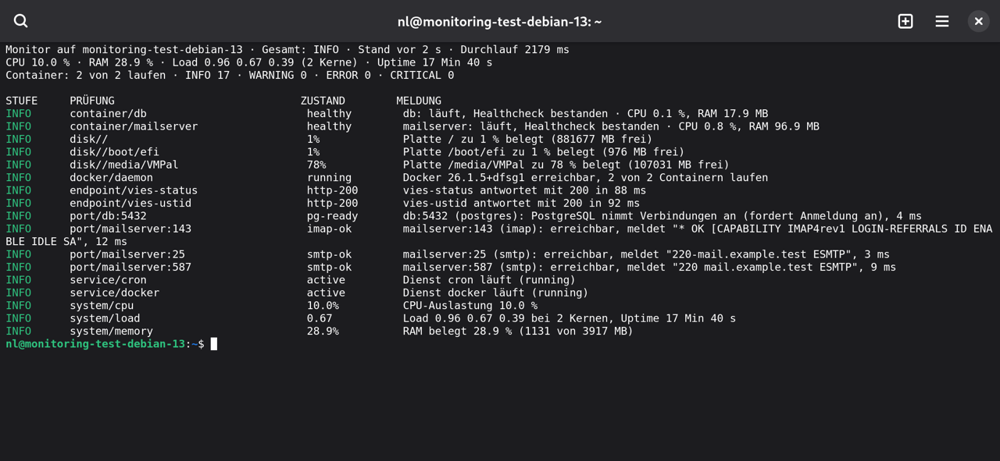

# 02 · Übersicht: Verfügbarkeit, Auslastung und Fehler beider Dienste

> Getestet am 06.11.2026 um 15:31:35 auf einer VMPal-VM (Debian 13) auf meinem MacBook.

**Anforderung:** AK 1 aus #14. Prompts: „Monitor Status command“, „Docker Socket … Ressourcen vom System“, „Pfade und Statistiken in den Status Meldungen“, „Festplatte und RAM und CPU Auslastung“.

**Ablauf:** Nach 25 s Laufzeit zeigt monitor status alle Prüfungen: Datenbank und Mailserver als Container und über ihre Ports, dazu System, Platten, Dienste und Schnittstellen.

**Im Bild zu sehen:** Aufruf von `monitor status` im Normalbetrieb (ohne `sudo`). Alle 17 Prüfungen stehen auf `INFO` – Container `db` und `mailserver`, ihre automatisch erkannten Ports (`5432`, `25`, `143`, `587`), Systemressourcen und die VIES-API.



## Befehle und Ausgaben

```console
root@monitoring-test-debian-13:~# monitor status
Monitor auf monitoring-test-debian-13 · Gesamt: CRITICAL · Stand vor 1 s · Durchlauf 4172 ms
CPU 12.0 % · RAM 30.5 % · Load 0.79 0.27 0.10 (2 Kerne) · Uptime 1 Min 59 s
Container: 5 von 11 laufen · INFO 22 · WARNING 3 · ERROR 4 · CRITICAL 1

STUFE     PRÜFUNG                             ZUSTAND        MELDUNG
CRITICAL  container/oom                        oom-killed     oom: vom Kernel beendet, Arbeitsspeicher reichte nicht (OOM)
ERROR     container/crashloop                  restarting     crashloop: startet neu (9 Neustarts, letzter Exit-Code 1)
ERROR     container/flapper                    unhealthy      flapper: Healthcheck meldet unhealthy (4 Fehlversuche in Folge) · CPU 1 %, RAM 0.3 MB
ERROR     container/job-fehler                 exited         job-fehler: beendet mit Fehler, Exit-Code 3
ERROR     container/web-unhealthy              unhealthy      web-unhealthy: Healthcheck meldet unhealthy (27 Fehlversuche in Folge) · CPU 1 %, RAM 0.3 MB
WARNING   container/angelegt                   created        angelegt: angelegt, aber nie gestartet
WARNING   container/pausiert                   paused         pausiert: pausiert
WARNING   container/web-starting               starting       web-starting: läuft, Healthcheck noch nicht bestanden · CPU 0 %, RAM 0.3 MB
INFO      container/db                         healthy        db: läuft, Healthcheck bestanden · CPU 1.3 %, RAM 34.3 MB
INFO      container/job-ok                     exited         job-ok: beendet mit Exit-Code 0 (einmaliger Job)
INFO      container/mailserver                 healthy        mailserver: läuft, Healthcheck bestanden · CPU 0.8 %, RAM 51.6 MB
INFO      disk//                               1%             Platte / zu 1 % belegt (881691 MB frei)
INFO      disk//srv/daten                      1%             Platte /srv/daten zu 1 % belegt (905 MB frei)
INFO      docker/daemon                        running        Docker 26.1.5+dfsg1 erreichbar, 5 von 11 Containern laufen
INFO      endpoint/test-api                    http-201       test-api antwortet mit 201 in 1 ms
INFO      endpoint/test-dienst                 http-200       test-dienst antwortet mit 200 in 1 ms
INFO      endpoint/test-health                 http-200       test-health antwortet mit 200 in 62 ms
INFO      endpoint/test-langsam                http-200       test-langsam antwortet mit 200 in 4001 ms
INFO      endpoint/vies-status                 http-200       vies-status antwortet mit 200 in 87 ms
INFO      endpoint/vies-ustid                  http-200       vies-ustid antwortet mit 200 in 126 ms
INFO      port/db:5432                         pg-ready       db:5432 (postgres): PostgreSQL nimmt Verbindungen an (fordert Anmeldung an), 4 ms
INFO      port/mailserver:143                  imap-ok        mailserver:143 (imap): erreichbar, meldet "* OK [CAPABILITY IMAP4rev1 LOGIN-REFERRALS ID ENABLE IDLE SA", 8 ms
INFO      port/mailserver:25                   smtp-ok        mailserver:25 (smtp): erreichbar, meldet "220-mail.example.test ESMTP", 5 ms
INFO      port/mailserver:587                  smtp-ok        mailserver:587 (smtp): erreichbar, meldet "220 mail.example.test ESMTP", 6 ms
INFO      service/cron                         active         Dienst cron läuft (running)
INFO      service/demo-dienst                  active         Dienst demo-dienst läuft (running)
INFO      service/docker                       active         Dienst docker läuft (running)
INFO      system/cpu                           12.0%          CPU-Auslastung 12.0 %
INFO      system/load                          0.27           Load 0.79 0.27 0.10 bei 2 Kernen, Uptime 1 Min 59 s
INFO      system/memory                        30.5%          RAM belegt 30.5 % (1195 von 3917 MB)
```
_Exit-Code 3 (monitor status und check: 1 WARNING, 2 ERROR, 3 CRITICAL, 4 kein Zustand oder Fehler)_

```console
root@monitoring-test-debian-13:~# monitor status --problems
Monitor auf monitoring-test-debian-13 · Gesamt: CRITICAL · Stand vor 1 s · Durchlauf 4172 ms
CPU 12.0 % · RAM 30.5 % · Load 0.79 0.27 0.10 (2 Kerne) · Uptime 1 Min 59 s
Container: 5 von 11 laufen · INFO 22 · WARNING 3 · ERROR 4 · CRITICAL 1

STUFE     PRÜFUNG                             ZUSTAND        MELDUNG
CRITICAL  container/oom                        oom-killed     oom: vom Kernel beendet, Arbeitsspeicher reichte nicht (OOM)
ERROR     container/crashloop                  restarting     crashloop: startet neu (9 Neustarts, letzter Exit-Code 1)
ERROR     container/flapper                    unhealthy      flapper: Healthcheck meldet unhealthy (4 Fehlversuche in Folge) · CPU 1 %, RAM 0.3 MB
ERROR     container/job-fehler                 exited         job-fehler: beendet mit Fehler, Exit-Code 3
ERROR     container/web-unhealthy              unhealthy      web-unhealthy: Healthcheck meldet unhealthy (27 Fehlversuche in Folge) · CPU 1 %, RAM 0.3 MB
WARNING   container/angelegt                   created        angelegt: angelegt, aber nie gestartet
WARNING   container/pausiert                   paused         pausiert: pausiert
WARNING   container/web-starting               starting       web-starting: läuft, Healthcheck noch nicht bestanden · CPU 0 %, RAM 0.3 MB
```
_Exit-Code 3 (monitor status und check: 1 WARNING, 2 ERROR, 3 CRITICAL, 4 kein Zustand oder Fehler)_

```console
root@monitoring-test-debian-13:~# monitor status --json | jq ".checks[] | select(.id == \"container/db\" or .id == \"port/mailserver:25\")"
{
  "id": "container/db",
  "kind": "container",
  "name": "db",
  "level": "INFO",
  "status": "healthy",
  "message": "db: läuft, Healthcheck bestanden · CPU 1.3 %, RAM 34.3 MB",
  "details": {
    "state": "running",
    "health": "healthy",
    "restart_count": 0,
    "cpu_percent": 1.3,
    "mem_mb": 34.3,
    "mem_limit_mb": 3917.7,
    "mem_percent": 0.9,
    "mounts": "/var/lib/docker/volumes/monitor-test-db/_data -> /var/lib/postgresql/data",
    "log_path": "/var/lib/docker/containers/1e8243ba1d0e0c4b4adbe4314898fd3bf31272fea716d326e650f48f9f3e4581/1e8243ba1d0e0c4b4adbe4314898fd3bf31272fea716d326e650f48f9f3e4581-json.log",
    "health_output": "/var/run/postgresql:5432 - accepting connections\n",
    "image": "postgres:17-alpine",
    "restart_policy": "unless-stopped",
    "started_at": "2026-11-06T14:30:58.959481085Z",
    "container_id": "1e8243ba1d0e",
    "hint": "docker logs --tail 50 db"
  }
}
{
  "id": "port/mailserver:25",
  "kind": "port",
  "name": "mailserver:25",
  "level": "INFO",
  "status": "smtp-ok",
  "message": "mailserver:25 (smtp): erreichbar, meldet \"220-mail.example.test ESMTP\", 5 ms",
  "details": {
    "type": "port",
    "container": "mailserver",
    "host": "127.0.0.1",
    "port": 25,
    "container_port": 25,
    "protocol": "smtp",
    "reply": "220-mail.example.test ESMTP",
    "time_ms": 5,
    "container_state": "running"
  }
}
```

## Prüfungen

- bestanden: db: läuft, healthy, INFO
- bestanden: mailserver (docker-mailserver): healthy, INFO
- bestanden: Übersicht zeigt CPU und RAM von db und mailserver
- bestanden: Datenbank-Port 5432: PostgreSQL nimmt Verbindungen an
- bestanden: Mailserver-Port 25: SMTP meldet 220
- bestanden: Mailserver-Port 143: IMAP meldet * OK
- bestanden: Mailserver-Port 587: SMTP meldet 220
- bestanden: CPU, RAM, Load und Uptime werden erfasst
- bestanden: Platten / und /srv/daten werden erfasst
- bestanden: Dienste docker, cron, demo-dienst: INFO
- bestanden: test-api: POST mit erwartetem 201
- bestanden: VIES-Testdienst (POST) antwortet 200
- bestanden: Meldungen enthalten Pfade (Mounts, Log-Datei)

## Server-Log

```console
root@monitoring-test-debian-13:~# journalctl -u monitor --since "2026-11-06 15:31:35" -o short-iso
2026-11-06T15:31:39+01:00 monitoring-test-debian-13 monitor[16523]: [CRITICAL] container/oom: oom: vom Kernel beendet, Arbeitsspeicher reichte nicht (OOM) (vorher INFO)
2026-11-06T15:31:39+01:00 monitoring-test-debian-13 monitor[16523]: [ERROR] container/crashloop: crashloop: Neustart-Schleife: 7 Neustarts, letzter vor 2 s (vorher INFO)
2026-11-06T15:31:39+01:00 monitoring-test-debian-13 monitor[16523]: [ERROR] container/flapper: flapper: Healthcheck meldet unhealthy (5 Fehlversuche in Folge) · CPU 0 %, RAM 0.3 MB (vorher INFO)
2026-11-06T15:31:39+01:00 monitoring-test-debian-13 monitor[16523]: [ERROR] container/job-fehler: job-fehler: beendet mit Fehler, Exit-Code 3 (vorher INFO)
2026-11-06T15:31:39+01:00 monitoring-test-debian-13 monitor[16523]: [ERROR] container/web-unhealthy: web-unhealthy: Healthcheck meldet unhealthy (17 Fehlversuche in Folge) · CPU 1 %, RAM 0.3 MB (vorher INFO)
2026-11-06T15:31:39+01:00 monitoring-test-debian-13 monitor[16523]: [WARNING] container/angelegt: angelegt: angelegt, aber nie gestartet (vorher INFO)
2026-11-06T15:31:39+01:00 monitoring-test-debian-13 monitor[16523]: [WARNING] container/pausiert: pausiert: pausiert (vorher INFO)
2026-11-06T15:31:39+01:00 monitoring-test-debian-13 monitor[16523]: [WARNING] container/web-starting: web-starting: läuft, Healthcheck noch nicht bestanden · CPU 0 %, RAM 0.3 MB (vorher INFO)
2026-11-06T15:31:39+01:00 monitoring-test-debian-13 monitor[16538]: [INFO] Meldung (change) an discord-test zugestellt (HTTP 204, Versuch 1)
2026-11-06T15:31:39+01:00 monitoring-test-debian-13 monitor[16552]: [INFO] Meldung (change) an json-test zugestellt (HTTP 204, Versuch 1)
2026-11-06T15:31:41+01:00 monitoring-test-debian-13 monitor[16566]: [INFO] Meldung (change) an wiederhol-test zugestellt (HTTP 204, Versuch 2)
2026-11-06T15:31:50+01:00 monitoring-test-debian-13 monitor[17634]: [INFO] container/flapper: flapper: läuft, Healthcheck bestanden · CPU 0.4 %, RAM 0.3 MB (vorher ERROR)
2026-11-06T15:31:50+01:00 monitoring-test-debian-13 monitor[17649]: [INFO] Meldung (change) an discord-test zugestellt (HTTP 204, Versuch 1)
2026-11-06T15:31:50+01:00 monitoring-test-debian-13 monitor[17663]: [INFO] Meldung (change) an json-test zugestellt (HTTP 204, Versuch 1)
2026-11-06T15:31:59+01:00 monitoring-test-debian-13 monitor[15250]: [INFO] container/flapper: Wechsel zu ERROR unterdrückt (Spam-Schutz, 2 Meldungen in 120 s)
```

## Angekommene Meldungen

| Nr. | Zeit | Webhook | Art | Stufe | Inhalt | Discord-Grenzen |
| --- | --- | --- | --- | --- | --- | --- |
| 0003 | 15:31:39 | discord | change | - | 🔴 CRITICAL · container/oom · 🟠 ERROR · container/crashloop · 🟠 ERROR · container/flapper · Weitere 5 Änderungen | ok (4 Embeds, 1413 Zeichen) |
| 0004 | 15:31:39 | json | change | CRITICAL | container/oom INFO->CRITICAL · container/crashloop INFO->ERROR · container/flapper INFO->ERROR · container/job-fehler INFO->ERROR · container/web-unhealthy INFO->ERROR · container/angelegt INFO->WARNING · container/pausiert INFO->WARNING · container/web-starting INFO->WARNING | - |
| 0005 | 15:31:41 | flaky | change | CRITICAL | container/oom INFO->CRITICAL | - |
| 0006 | 15:31:50 | discord | change | - | 🟢 INFO · container/flapper | ok (1 Embeds, 251 Zeichen) |
| 0007 | 15:31:50 | json | change | INFO | container/flapper ERROR->INFO | - |

### JSON-Meldung Nr. 0004 im Original

```json
{
  "schema": "monitor.event/v1",
  "type": "change",
  "host": "monitoring-test-debian-13",
  "time": "2026-11-06T15:31:39+01:00",
  "level": "CRITICAL",
  "summary": {
    "level": "CRITICAL",
    "counts": {
      "INFO": 22,
      "WARNING": 3,
      "ERROR": 4,
      "CRITICAL": 1
    },
    "system": {
      "cpu_percent": 16.0,
      "mem_percent": 30.8,
      "mem_total_mb": 3917,
      "load1": 0.84,
      "load5": 0.25,
      "load15": 0.09,
      "cores": 2,
      "uptime_seconds": 100,
      "uptime": "1 Min 40 s",
      "disks": [
        {
          "mount": "/srv/daten",
          "used_percent": 1,
          "free_mb": 905,
          "level": "INFO"
        },
        {
          "mount": "/",
          "used_percent": 1,
          "free_mb": 881691,
          "level": "INFO"
        }
      ]
    },
    "containers": {
      "total": 11,
      "running": 6,
      "problems": 8
    }
  },
  "events": [
    {
      "id": "container/oom",
      "kind": "container",
      "name": "oom",
      "level": "CRITICAL",
      "status": "oom-killed",
      "message": "oom: vom Kernel beendet, Arbeitsspeicher reichte nicht (OOM)",
      "details": {
        "state": "exited",
        "health": "none",
        "exit_code": 137,
        "restart_count": 0,
        "log_path": "/var/lib/docker/containers/2ba607993f2bc569651e3cce91c6908ca7274188299574e9c4292a9544373e1a/2ba607993f2bc569651e3cce91c6908ca7274188299574e9c4292a9544373e1a-json.log",
        "image": "alpine:3.22",
        "restart_policy": "no",
        "started_at": "2026-11-06T14:31:00.945337415Z",
        "finished_at": "2026-11-06T14:31:00.971219436Z",
        "oom_killed": true,
        "container_id": "2ba607993f2b",
        "hint": "docker logs --tail 50 oom"
      },
      "previous_level": "INFO",
      "change": "worse",
      "suppressed_changes": 0
    },
    {
      "id": "container/crashloop",
      "kind": "container",
      "name": "crashloop",
      "level": "ERROR",
      "status": "restart-loop",
      "message": "crashloop: Neustart-Schleife: 7 Neustarts, letzter vor 2 s",
      "details": {
        "state": "running",
        "health": "none",
        "restart_count": 7,
        "log_path": "/var/lib/docker/containers/b8ff615aaf4de2a24272ef133f959de562c398b9626121e00369d2c7879f0c6c/b8ff615aaf4de2a24272ef133f959de562c398b9626121e00369d2c7879f0c6c-json.log",
        "image": "alpine:3.22",
        "restart_policy": "always",
        "started_at": "2026-11-06T14:31:35.693145353Z",
        "finished_at": "2026-11-06T14:31:29.252890258Z",
        "container_id": "b8ff615aaf4d",
        "hint": "docker logs --tail 50 crashloop"
      },
… 154 Zeilen gekürzt …
```

### Discord-Meldung Nr. 0003 im Original

```json
{
  "username": "Monitor monitoring-test-debian-13",
  "content": "🔴 **CRITICAL** auf **monitoring-test-debian-13**",
  "embeds": [
    {
      "title": "🔴 CRITICAL · container/oom",
      "description": "oom: vom Kernel beendet, Arbeitsspeicher reichte nicht (OOM)\nvorher INFO, jetzt CRITICAL",
      "color": 15158332,
      "fields": [
        {
          "name": "state",
          "value": "exited",
          "inline": true
        },
        {
          "name": "health",
          "value": "none",
          "inline": true
        },
        {
          "name": "exit_code",
          "value": "137",
          "inline": true
        },
        {
          "name": "restart_count",
          "value": "0",
          "inline": true
        },
        {
          "name": "log_path",
          "value": "/var/lib/docker/containers/2ba607993f2bc569651e3cce91c6908ca7274188299574e9c4292a9544373e1a/2ba607993f2bc569651e3cce91c6908ca7274188299574e9c4292a954…",
          "inline": false
        },
        {
          "name": "image",
          "value": "alpine:3.22",
          "inline": true
        },
        {
          "name": "restart_policy",
          "value": "no",
          "inline": true
        }
      ],
      "timestamp": "2026-11-06T15:31:39+01:00",
      "footer": {
        "text": "monitoring-test-debian-13 · container · oom-killed"
      }
    },
    {
      "title": "🟠 ERROR · container/crashloop",
      "description": "crashloop: Neustart-Schleife: 7 Neustarts, letzter vor 2 s\nvorher INFO, jetzt ERROR",
      "color": 15105570,
      "fields": [
        {
          "name": "state",
          "value": "running",
          "inline": true
        },
        {
          "name": "health",
          "value": "none",
          "inline": true
        },
        {
          "name": "restart_count",
          "value": "7",
          "inline": true
        },
        {
          "name": "log_path",
          "value": "/var/lib/docker/containers/b8ff615aaf4de2a24272ef133f959de562c398b9626121e00369d2c7879f0c6c/b8ff615aaf4de2a24272ef133f959de562c398b9626121e00369d2c78…",
          "inline": false
        },
        {
          "name": "image",
          "value": "alpine:3.22",
          "inline": true
        },
        {
          "name": "restart_policy",
          "value": "always",
          "inline": true
        },
        {
          "name": "started_at",
          "value": "2026-11-06T14:31:35.693145353Z",
          "inline": false
        }
… 59 Zeilen gekürzt …
```

