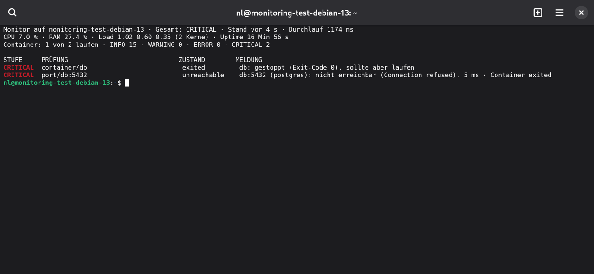

# 05 · Fall 1a: Datenbank nicht erreichbar

> Getestet am 06.11.2026 um 15:32:00 auf einer VMPal-VM (Debian 13) auf meinem MacBook.

**Anforderung:** AK 2 und 3 aus #14: „Bei nicht erreichbarem Dienst … wird eine Benachrichtigung ausgelöst“, „künstlich herbeigeführt und die Benachrichtigung ist angekommen“.

**Ablauf:** Der Container db wird gestoppt. Erwartet: CRITICAL für den Container und für den Port 5432 an Discord und JSON, nach dem Start eine Entwarnung.

**Im Bild zu sehen:** Nach `docker stop db` zeigt `monitor status --problems` nur noch die akuten Störungen: sowohl `container/db` (`exited`) als auch `port/db:5432` (`Connection refused`) stehen in Rot auf `CRITICAL`.



## Befehle und Ausgaben

```console
root@monitoring-test-debian-13:~# docker stop db
db
```

```console
root@monitoring-test-debian-13:~# monitor status --problems
Monitor auf monitoring-test-debian-13 · Gesamt: CRITICAL · Stand vor 1 s · Durchlauf 4208 ms
CPU 12.1 % · RAM 29.5 % · Load 0.56 0.25 0.09 (2 Kerne) · Uptime 2 Min 15 s
Container: 4 von 11 laufen · INFO 21 · WARNING 3 · ERROR 3 · CRITICAL 3

STUFE     PRÜFUNG                             ZUSTAND        MELDUNG
CRITICAL  container/db                         exited         db: gestoppt (Exit-Code 0), sollte aber laufen
CRITICAL  container/oom                        oom-killed     oom: vom Kernel beendet, Arbeitsspeicher reichte nicht (OOM)
CRITICAL  port/db:5432                         unreachable    db:5432 (postgres): nicht erreichbar (Connection refused), 3 ms · Container exited
ERROR     container/crashloop                  restarting     crashloop: startet neu (9 Neustarts, letzter Exit-Code 1)
ERROR     container/job-fehler                 exited         job-fehler: beendet mit Fehler, Exit-Code 3
ERROR     container/web-unhealthy              unhealthy      web-unhealthy: Healthcheck meldet unhealthy (34 Fehlversuche in Folge) · CPU 0 %, RAM 0.3 MB
WARNING   container/angelegt                   created        angelegt: angelegt, aber nie gestartet
WARNING   container/pausiert                   paused         pausiert: pausiert
WARNING   container/web-starting               starting       web-starting: läuft, Healthcheck noch nicht bestanden · CPU 0 %, RAM 0.3 MB
```
_Exit-Code 3 (monitor status und check: 1 WARNING, 2 ERROR, 3 CRITICAL, 4 kein Zustand oder Fehler)_

```console
root@monitoring-test-debian-13:~# docker start db
db
```

## Prüfungen

- bestanden: JSON-Webhook: container/db CRITICAL angekommen
- bestanden: JSON-Webhook: port/db:5432 CRITICAL angekommen
- bestanden: Discord-Webhook: Meldung zu container/db angekommen
- bestanden: Port-Meldung nennt Connection refused und den gestoppten Container
- bestanden: Entwarnung: container/db wieder INFO
- bestanden: Entwarnung: port/db:5432 wieder INFO

## Beobachtungen

- Erkannt und gemeldet nach 14 s (Intervall 5 s, Bestätigung über 2 Durchläufe).
- Entwarnung nach 16 s.

## Server-Log

```console
root@monitoring-test-debian-13:~# journalctl -u monitor --since "2026-11-06 15:32:00" -o short-iso
2026-11-06T15:32:09+01:00 monitoring-test-debian-13 monitor[20548]: [CRITICAL] port/db:5432: db:5432 (postgres): nicht erreichbar (Connection refused), 3 ms · Container exited (vorher INFO)
2026-11-06T15:32:09+01:00 monitoring-test-debian-13 monitor[20563]: [INFO] Meldung (change) an discord-test zugestellt (HTTP 204, Versuch 1)
2026-11-06T15:32:09+01:00 monitoring-test-debian-13 monitor[20576]: [INFO] Meldung (change) an json-test zugestellt (HTTP 204, Versuch 1)
2026-11-06T15:32:11+01:00 monitoring-test-debian-13 monitor[20591]: [INFO] Meldung (change) an wiederhol-test zugestellt (HTTP 204, Versuch 2)
2026-11-06T15:32:14+01:00 monitoring-test-debian-13 monitor[21139]: [CRITICAL] container/db: db: gestoppt (Exit-Code 0), sollte aber laufen (vorher INFO)
2026-11-06T15:32:14+01:00 monitoring-test-debian-13 monitor[21154]: [INFO] Meldung (change) an discord-test zugestellt (HTTP 204, Versuch 1)
2026-11-06T15:32:14+01:00 monitoring-test-debian-13 monitor[21168]: [INFO] Meldung (change) an json-test zugestellt (HTTP 204, Versuch 1)
2026-11-06T15:32:17+01:00 monitoring-test-debian-13 monitor[21182]: [INFO] Meldung (change) an wiederhol-test zugestellt (HTTP 204, Versuch 2)
2026-11-06T15:32:25+01:00 monitoring-test-debian-13 monitor[15250]: [INFO] container/flapper: Wechsel zu ERROR unterdrückt (Spam-Schutz, 2 Meldungen in 120 s)
2026-11-06T15:32:25+01:00 monitoring-test-debian-13 monitor[22639]: [INFO] port/db:5432: db:5432 (postgres): PostgreSQL nimmt Verbindungen an (fordert Anmeldung an), 4 ms (vorher CRITICAL)
2026-11-06T15:32:25+01:00 monitoring-test-debian-13 monitor[22654]: [INFO] Meldung (change) an discord-test zugestellt (HTTP 204, Versuch 1)
2026-11-06T15:32:25+01:00 monitoring-test-debian-13 monitor[22666]: [INFO] Meldung (change) an json-test zugestellt (HTTP 204, Versuch 1)
2026-11-06T15:32:27+01:00 monitoring-test-debian-13 monitor[22682]: [INFO] Meldung (change) an wiederhol-test zugestellt (HTTP 204, Versuch 2)
2026-11-06T15:32:30+01:00 monitoring-test-debian-13 monitor[23302]: [INFO] container/db: db: läuft, Healthcheck bestanden · CPU 0 %, RAM 17.8 MB (vorher CRITICAL)
2026-11-06T15:32:30+01:00 monitoring-test-debian-13 monitor[23317]: [INFO] Meldung (change) an discord-test zugestellt (HTTP 204, Versuch 1)
2026-11-06T15:32:30+01:00 monitoring-test-debian-13 monitor[23331]: [INFO] Meldung (change) an json-test zugestellt (HTTP 204, Versuch 1)
```

## Angekommene Meldungen

| Nr. | Zeit | Webhook | Art | Stufe | Inhalt | Discord-Grenzen |
| --- | --- | --- | --- | --- | --- | --- |
| 0008 | 15:32:09 | discord | change | - | 🔴 CRITICAL · port/db:5432 | ok (1 Embeds, 263 Zeichen) |
| 0009 | 15:32:09 | json | change | CRITICAL | port/db:5432 INFO->CRITICAL | - |
| 0010 | 15:32:11 | flaky | change | CRITICAL | port/db:5432 INFO->CRITICAL | - |
| 0011 | 15:32:14 | discord | change | - | 🔴 CRITICAL · container/db | ok (1 Embeds, 494 Zeichen) |
| 0012 | 15:32:14 | json | change | CRITICAL | container/db INFO->CRITICAL | - |
| 0013 | 15:32:17 | flaky | change | CRITICAL | container/db INFO->CRITICAL | - |
| 0014 | 15:32:25 | discord | change | - | 🟢 INFO · port/db:5432 | ok (1 Embeds, 253 Zeichen) |
| 0015 | 15:32:25 | json | change | INFO | port/db:5432 CRITICAL->INFO | - |
| 0016 | 15:32:27 | flaky | change | INFO | port/db:5432 CRITICAL->INFO | - |
| 0017 | 15:32:30 | discord | change | - | 🟢 INFO · container/db | ok (1 Embeds, 244 Zeichen) |
| 0018 | 15:32:30 | json | change | INFO | container/db CRITICAL->INFO | - |

### JSON-Meldung Nr. 0009 im Original

```json
{
  "schema": "monitor.event/v1",
  "type": "change",
  "host": "monitoring-test-debian-13",
  "time": "2026-11-06T15:32:09+01:00",
  "level": "CRITICAL",
  "summary": {
    "level": "CRITICAL",
    "counts": {
      "INFO": 21,
      "WARNING": 3,
      "ERROR": 3,
      "CRITICAL": 3
    },
    "system": {
      "cpu_percent": 13.4,
      "mem_percent": 29.4,
      "mem_total_mb": 3917,
      "load1": 0.61,
      "load5": 0.26,
      "load15": 0.09,
      "cores": 2,
      "uptime_seconds": 130,
      "uptime": "2 Min 10 s",
      "disks": [
        {
          "mount": "/srv/daten",
          "used_percent": 1,
          "free_mb": 905,
          "level": "INFO"
        },
        {
          "mount": "/",
          "used_percent": 1,
          "free_mb": 881691,
          "level": "INFO"
        }
      ]
    },
    "containers": {
      "total": 11,
      "running": 4,
      "problems": 8
    }
  },
  "events": [
    {
      "id": "port/db:5432",
      "kind": "port",
      "name": "db:5432",
      "level": "CRITICAL",
      "status": "unreachable",
      "message": "db:5432 (postgres): nicht erreichbar (Connection refused), 3 ms · Container exited",
      "details": {
        "type": "port",
        "container": "db",
        "host": "127.0.0.1",
        "port": 5432,
        "container_port": 5432,
        "protocol": "postgres",
        "time_ms": 3,
        "container_state": "exited"
      },
      "previous_level": "INFO",
      "change": "worse",
      "suppressed_changes": 0
    }
  ]
}
```

### Discord-Meldung Nr. 0008 im Original

```json
{
  "username": "Monitor monitoring-test-debian-13",
  "content": "🔴 **CRITICAL** auf **monitoring-test-debian-13**",
  "embeds": [
    {
      "title": "🔴 CRITICAL · port/db:5432",
      "description": "db:5432 (postgres): nicht erreichbar (Connection refused), 3 ms · Container exited\nvorher INFO, jetzt CRITICAL",
      "color": 15158332,
      "fields": [
        {
          "name": "type",
          "value": "port",
          "inline": true
        },
        {
          "name": "container",
          "value": "db",
          "inline": true
        },
        {
          "name": "host",
          "value": "127.0.0.1",
          "inline": true
        },
        {
          "name": "port",
          "value": "5432",
          "inline": true
        },
        {
          "name": "container_port",
          "value": "5432",
          "inline": true
        },
        {
          "name": "protocol",
          "value": "postgres",
          "inline": true
        },
        {
          "name": "time_ms",
          "value": "3",
          "inline": true
        }
      ],
      "timestamp": "2026-11-06T15:32:09+01:00",
      "footer": {
        "text": "monitoring-test-debian-13 · port · unreachable"
      }
    }
  ]
}
```

