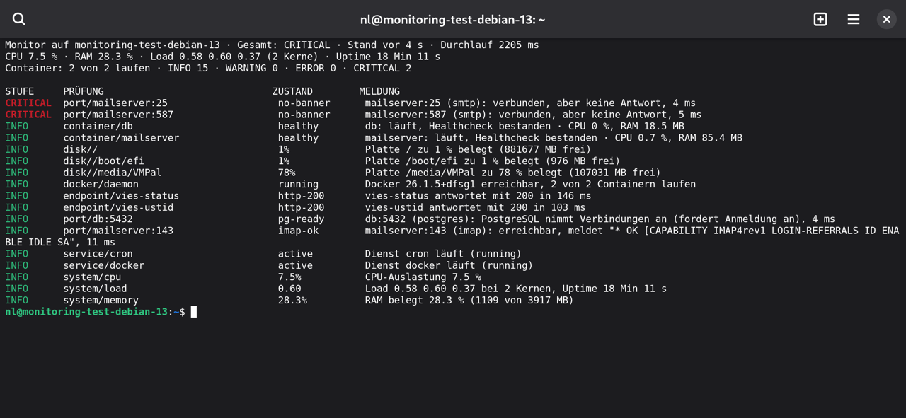

# 11 · Fall 1e: Dienst im laufenden Container ausgefallen (Postfix)

> Getestet am 06.11.2026 um 15:35:16 auf einer VMPal-VM (Debian 13) auf meinem MacBook.

**Anforderung:** AK 2 aus #14. ADR 0012: Der Healthcheck von docker-mailserver prüft nur Prozesse, SMTP muss das Monitoring selbst prüfen.

**Ablauf:** Im laufenden Container mailserver wird nur Postfix gestoppt (supervisorctl). Der Container läuft weiter. Erwartet: CRITICAL für die SMTP-Ports 25 und 587, IMAP (Dovecot) bleibt INFO, nach dem Start Entwarnung.

**Im Bild zu sehen:** Nach `docker exec mailserver supervisorctl stop postfix` läuft der Container selbst weiter und steht in `monitor status` noch grün auf `INFO healthy`. Erst unsere Port-Prüfung erkennt den Ausfall: `port/mailserver:25` und `587` stehen rot auf `CRITICAL` (`no-banner`), während IMAP (`143`) grün bleibt.



## Befehle und Ausgaben

```console
root@monitoring-test-debian-13:~# docker exec mailserver supervisorctl stop postfix
postfix: stopped
```

```console
root@monitoring-test-debian-13:~# docker ps --filter name=mailserver --format 'table {{.Names}}\t{{.Status}}'
NAMES        STATUS
mailserver   Up 2 minutes (healthy)
```

```console
root@monitoring-test-debian-13:~# monitor status --problems
Monitor auf monitoring-test-debian-13 · Gesamt: CRITICAL · Stand vor 2 s · Durchlauf 4245 ms
CPU 18.6 % · RAM 30.1 % · Load 0.53 0.38 0.17 (2 Kerne) · Uptime 5 Min 26 s
Container: 6 von 11 laufen · INFO 21 · WARNING 3 · ERROR 3 · CRITICAL 3

STUFE     PRÜFUNG                             ZUSTAND        MELDUNG
CRITICAL  container/oom                        oom-killed     oom: vom Kernel beendet, Arbeitsspeicher reichte nicht (OOM)
CRITICAL  port/mailserver:25                   no-banner      mailserver:25 (smtp): verbunden, aber keine Antwort, 3 ms
CRITICAL  port/mailserver:587                  no-banner      mailserver:587 (smtp): verbunden, aber keine Antwort, 2 ms
ERROR     container/crashloop                  restart-loop   crashloop: Neustart-Schleife: 12 Neustarts, letzter vor 2 s · CPU 0 %, RAM 0.4 MB
ERROR     container/job-fehler                 exited         job-fehler: beendet mit Fehler, Exit-Code 3
ERROR     container/web-unhealthy              unhealthy      web-unhealthy: Healthcheck meldet unhealthy (128 Fehlversuche in Folge) · CPU 1.4 %, RAM 1.6 MB
WARNING   container/angelegt                   created        angelegt: angelegt, aber nie gestartet
WARNING   container/pausiert                   paused         pausiert: pausiert
WARNING   container/web-starting               starting       web-starting: läuft, Healthcheck noch nicht bestanden · CPU 0 %, RAM 0.3 MB
```
_Exit-Code 3 (monitor status und check: 1 WARNING, 2 ERROR, 3 CRITICAL, 4 kein Zustand oder Fehler)_

```console
root@monitoring-test-debian-13:~# docker exec mailserver supervisorctl start postfix
postfix: started
```

## Prüfungen

- bestanden: port/mailserver:25 CRITICAL, während der Container läuft
- bestanden: port/mailserver:587 CRITICAL
- bestanden: IMAP (Dovecot) bleibt erreichbar
- bestanden: Entwarnung port/mailserver:25

## Beobachtungen

- Gemeldet nach 10 s. Docker meldet den Container dabei als: running, Healthcheck healthy.

## Server-Log

```console
root@monitoring-test-debian-13:~# journalctl -u monitor --since "2026-11-06 15:35:16" -o short-iso
2026-11-06T15:35:26+01:00 monitoring-test-debian-13 monitor[47531]: [CRITICAL] port/mailserver:25: mailserver:25 (smtp): verbunden, aber keine Antwort, 3 ms (vorher INFO)
2026-11-06T15:35:26+01:00 monitoring-test-debian-13 monitor[47531]: [CRITICAL] port/mailserver:587: mailserver:587 (smtp): verbunden, aber keine Antwort, 2 ms (vorher INFO)
2026-11-06T15:35:26+01:00 monitoring-test-debian-13 monitor[47546]: [INFO] Meldung (change) an discord-test zugestellt (HTTP 204, Versuch 1)
2026-11-06T15:35:26+01:00 monitoring-test-debian-13 monitor[47559]: [INFO] Meldung (change) an json-test zugestellt (HTTP 204, Versuch 1)
2026-11-06T15:35:28+01:00 monitoring-test-debian-13 monitor[47574]: [INFO] Meldung (change) an wiederhol-test zugestellt (HTTP 204, Versuch 2)
2026-11-06T15:35:35+01:00 monitoring-test-debian-13 monitor[15250]: [INFO] container/flapper: Wechsel zu ERROR unterdrückt (Spam-Schutz, 2 Meldungen in 120 s)
2026-11-06T15:35:35+01:00 monitoring-test-debian-13 monitor[49086]: [INFO] port/mailserver:25: mailserver:25 (smtp): erreichbar, meldet "220-mail.example.test ESMTP", 4 ms (vorher CRITICAL)
2026-11-06T15:35:35+01:00 monitoring-test-debian-13 monitor[49086]: [INFO] port/mailserver:587: mailserver:587 (smtp): erreichbar, meldet "220 mail.example.test ESMTP", 23 ms (vorher CRITICAL)
2026-11-06T15:35:35+01:00 monitoring-test-debian-13 monitor[49101]: [INFO] Meldung (change) an discord-test zugestellt (HTTP 204, Versuch 1)
2026-11-06T15:35:35+01:00 monitoring-test-debian-13 monitor[49117]: [INFO] Meldung (change) an json-test zugestellt (HTTP 204, Versuch 1)
2026-11-06T15:35:35+01:00 monitoring-test-debian-13 monitor[49149]: [INFO] Meldung (report) an discord-test zugestellt (HTTP 204, Versuch 1)
2026-11-06T15:35:35+01:00 monitoring-test-debian-13 monitor[49159]: [INFO] Meldung (report) an json-test zugestellt (HTTP 204, Versuch 1)
```

## Angekommene Meldungen

| Nr. | Zeit | Webhook | Art | Stufe | Inhalt | Discord-Grenzen |
| --- | --- | --- | --- | --- | --- | --- |
| 0059 | 15:35:26 | discord | change | - | 🔴 CRITICAL · port/mailserver:25 · 🔴 CRITICAL · port/mailserver:587 | ok (2 Embeds, 488 Zeichen) |
| 0060 | 15:35:26 | json | change | CRITICAL | port/mailserver:25 INFO->CRITICAL · port/mailserver:587 INFO->CRITICAL | - |
| 0061 | 15:35:28 | flaky | change | CRITICAL | port/mailserver:25 INFO->CRITICAL · port/mailserver:587 INFO->CRITICAL | - |
| 0062 | 15:35:35 | discord | change | - | 🟢 INFO · port/mailserver:25 · 🟢 INFO · port/mailserver:587 | ok (2 Embeds, 563 Zeichen) |
| 0063 | 15:35:35 | json | change | INFO | port/mailserver:25 CRITICAL->INFO · port/mailserver:587 CRITICAL->INFO | - |
| 0064 | 15:35:35 | discord | report | - | 🔴 Bericht monitoring-test-debian-13: CRITICAL | ok (1 Embeds, 808 Zeichen) |
| 0065 | 15:35:35 | json | report | CRITICAL | Probleme: 8 | - |

### JSON-Meldung Nr. 0060 im Original

```json
{
  "schema": "monitor.event/v1",
  "type": "change",
  "host": "monitoring-test-debian-13",
  "time": "2026-11-06T15:35:25+01:00",
  "level": "CRITICAL",
  "summary": {
    "level": "CRITICAL",
    "counts": {
      "INFO": 21,
      "WARNING": 3,
      "ERROR": 3,
      "CRITICAL": 3
    },
    "system": {
      "cpu_percent": 18.6,
      "mem_percent": 30.1,
      "mem_total_mb": 3917,
      "load1": 0.53,
      "load5": 0.38,
      "load15": 0.17,
      "cores": 2,
      "uptime_seconds": 326,
      "uptime": "5 Min 26 s",
      "disks": [
        {
          "mount": "/srv/daten",
          "used_percent": 1,
          "free_mb": 905,
          "level": "INFO"
        },
        {
          "mount": "/",
          "used_percent": 1,
          "free_mb": 881640,
          "level": "INFO"
        }
      ]
    },
    "containers": {
      "total": 11,
      "running": 6,
      "problems": 7
    }
  },
  "events": [
    {
      "id": "port/mailserver:25",
      "kind": "port",
      "name": "mailserver:25",
      "level": "CRITICAL",
      "status": "no-banner",
      "message": "mailserver:25 (smtp): verbunden, aber keine Antwort, 3 ms",
      "details": {
        "type": "port",
        "container": "mailserver",
        "host": "127.0.0.1",
        "port": 25,
        "container_port": 25,
        "protocol": "smtp",
        "time_ms": 3,
        "container_state": "running"
      },
      "previous_level": "INFO",
      "change": "worse",
      "suppressed_changes": 0
    },
    {
      "id": "port/mailserver:587",
      "kind": "port",
      "name": "mailserver:587",
      "level": "CRITICAL",
      "status": "no-banner",
      "message": "mailserver:587 (smtp): verbunden, aber keine Antwort, 2 ms",
      "details": {
        "type": "port",
        "container": "mailserver",
        "host": "127.0.0.1",
        "port": 587,
        "container_port": 587,
        "protocol": "smtp",
        "time_ms": 2,
        "container_state": "running"
      },
      "previous_level": "INFO",
      "change": "worse",
      "suppressed_changes": 0
    }
  ]
}
```

### Discord-Meldung Nr. 0059 im Original

```json
{
  "username": "Monitor monitoring-test-debian-13",
  "content": "🔴 **CRITICAL** auf **monitoring-test-debian-13**",
  "embeds": [
    {
      "title": "🔴 CRITICAL · port/mailserver:25",
      "description": "mailserver:25 (smtp): verbunden, aber keine Antwort, 3 ms\nvorher INFO, jetzt CRITICAL",
      "color": 15158332,
      "fields": [
        {
          "name": "type",
          "value": "port",
          "inline": true
        },
        {
          "name": "container",
          "value": "mailserver",
          "inline": true
        },
        {
          "name": "host",
          "value": "127.0.0.1",
          "inline": true
        },
        {
          "name": "port",
          "value": "25",
          "inline": true
        },
        {
          "name": "container_port",
          "value": "25",
          "inline": true
        },
        {
          "name": "protocol",
          "value": "smtp",
          "inline": true
        },
        {
          "name": "time_ms",
          "value": "3",
          "inline": true
        }
      ],
      "timestamp": "2026-11-06T15:35:25+01:00",
      "footer": {
        "text": "monitoring-test-debian-13 · port · no-banner"
      }
    },
    {
      "title": "🔴 CRITICAL · port/mailserver:587",
      "description": "mailserver:587 (smtp): verbunden, aber keine Antwort, 2 ms\nvorher INFO, jetzt CRITICAL",
      "color": 15158332,
      "fields": [
        {
          "name": "type",
          "value": "port",
          "inline": true
        },
        {
          "name": "container",
          "value": "mailserver",
          "inline": true
        },
        {
          "name": "host",
          "value": "127.0.0.1",
          "inline": true
        },
        {
          "name": "port",
          "value": "587",
          "inline": true
        },
        {
          "name": "container_port",
          "value": "587",
          "inline": true
        },
        {
          "name": "protocol",
          "value": "smtp",
          "inline": true
        },
        {
          "name": "time_ms",
          "value": "2",
          "inline": true
        }
… 8 Zeilen gekürzt …
```

