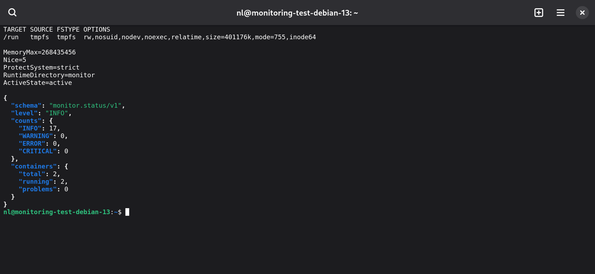

# 16 · Kein Schreiben auf die Platte

> Getestet am 06.11.2026 um 15:38:00 auf einer VMPal-VM (Debian 13) auf meinem MacBook.

**Anforderung:** Prompt: „Das Skript muss im RAM laufen damit der Speicherplatz nicht belegt wird und nicht irgendwo die Daten hinschreiben“.

**Ablauf:** Der Dienst sieht das ganze Dateisystem schreibgeschützt (ProtectSystem=strict). Beschreibbar ist nur /run/monitor, und das liegt im RAM.

**Im Bild zu sehen:** Drei Prüf-Befehle hintereinander: `findmnt -T /run/monitor` zeigt `tmpfs` (RAM), `systemctl show monitor …` zeigt `ProtectSystem=strict` und `MemoryMax=268435456` (256 MB), und `monitor status --json | jq …` zeigt das feste JSON-Schema `monitor.status/v1`.



## Befehle und Ausgaben

```console
root@monitoring-test-debian-13:~# systemctl show monitor -p ProtectSystem -p ProtectHome -p RuntimeDirectory -p MemoryMax -p Nice
MemoryMax=268435456
Nice=5
ProtectHome=read-only
ProtectSystem=strict
RuntimeDirectory=monitor
```

```console
root@monitoring-test-debian-13:~# findmnt -T /run/monitor
TARGET SOURCE FSTYPE OPTIONS
/run   tmpfs  tmpfs  rw,nosuid,nodev,noexec,relatime,size=401176k,mode=755,inode64
```

```console
root@monitoring-test-debian-13:~# ls -la /run/monitor
total 24
drwxr-xr-x  4 root root   120 Nov 23 15:37 .
drwxr-xr-x 25 root root   640 Nov 23 15:36 ..
drwx------  2 root root    40 Nov 23 15:37 outbox
-rw-r--r--  1 root root   176 Nov 23 15:37 ports.tsv
-rw-r--r--  1 root root 19693 Nov 23 15:37 status.json
drwxr-xr-x  3 root root    60 Nov 23 15:37 work
```

```console
root@monitoring-test-debian-13:~# grep -E ' / / | /run/monitor ' /proc/15250/mountinfo
840 286 254:3 / / ro,nosuid,relatime shared:234 master:1 - ext4 /dev/vda3 rw,errors=remount-ro
849 846 0:27 /monitor /run/monitor rw,nosuid,nodev,noexec,relatime shared:498 master:5 - tmpfs tmpfs rw,size=401176k,mode=755,inode64
```

```console
root@monitoring-test-debian-13:~# nsenter -t 15250 -m touch /var/lib/monitor-schreibtest
touch: cannot touch '/var/lib/monitor-schreibtest': Read-only file system
```
_Exit-Code 1_

## Prüfungen

- bestanden: Wurzeldateisystem ist für den Dienst schreibgeschützt
- bestanden: /run/monitor liegt auf tmpfs (RAM)
- bestanden: Schreibversuch aus dem Dienst-Kontext nach /var/lib scheitert

## Server-Log

```console
root@monitoring-test-debian-13:~# journalctl -u monitor --since "2026-11-06 15:38:00" -o short-iso
-- No entries --
```

## Angekommene Meldungen

In diesem Schritt kam keine Meldung.

